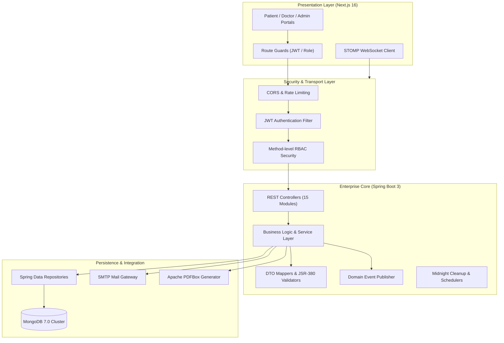

# 🏥 MediCore Enterprise — Hospital Management System (HMS)

[](https://spring.io/projects/spring-boot)
[](https://www.oracle.com/java/)
[](https://nextjs.org/)
[](https://react.dev/)
[](https://www.mongodb.com/)
[](https://www.docker.com/)
[](.github/workflows/ci.yml)

> **MediCore** is a production-grade, enterprise-ready Hospital Management System built using a decoupled client-server architecture with Spring Boot 3, Next.js 16, and MongoDB. Designed following Enterprise Application Development (EAD) best practices, domain-driven design, and multi-tier security standards.

---

## 🏛️ System Architecture



---

## 🚀 Key Enterprise Features

- **🔐 Robust Identity & Access Management (IAM):** Stateless JWT authentication with refresh token rotation, bcrypt password hashing, session expiration guards, and role-based permissions (`ADMIN`, `DOCTOR`, `PATIENT`).
- **🛡️ Defense-in-Depth Security:** In-memory sliding window rate limiting (IP-based protection against DoS/brute force attacks), sanitized error response payloads, and CORS domain whitelisting.
- **⚡ Real-Time Clinical Events:** Native STOMP WebSocket broker delivering instant alerts for appointment bookings, doctor availability changes, and emergency notifications.
- **📑 Document Automation:** High-fidelity prescription PDF generation built on Apache PDFBox with digital headers and hospital metadata.
- **📈 Comprehensive Analytics & Auditing:** Automated audit logs tracking clinical events, bed allocation matrices, and administrative revenue metrics.
- **⏱️ Automated Schedulers:** Background token cleanup and automated 24-hour appointment reminders.

---

## 📁 Enterprise Repository Layout

```
HospitalManagementSystem/
│
├── 📁 backend/                       # Enterprise Spring Boot Application
│   ├── 📁 src/main/java/com/hospital/backend/
│   │   ├── 📁 config/                # SecurityConfig, CorsConfig, RateLimitInterceptor, WebSocketConfig
│   │   ├── 📁 constant/              # AppConstants, ErrorCodes registry
│   │   ├── 📁 controller/            # 15 REST API controllers
│   │   ├── 📁 dto/                   # DTOs + dto/common (ApiResponse, PagedResponse, ErrorResponse)
│   │   ├── 📁 enums/                 # Role, AppointmentStatus, BedStatus
│   │   ├── 📁 event/                 # Domain Events & Event Publisher
│   │   ├── 📁 exception/             # GlobalExceptionHandler, Custom Exceptions
│   │   ├── 📁 mapper/                # DTO ↔ Entity Mappers
│   │   ├── 📁 model/                 # 17 MongoDB Document Entities
│   │   ├── 📁 repository/            # 17 Spring Data MongoDB Repositories
│   │   ├── 📁 scheduler/             # Scheduled background jobs
│   │   ├── 📁 security/              # JwtService, CustomUserDetailsService
│   │   ├── 📁 service/               # Service interfaces & service/impl implementations
│   │   └── 📁 validation/            # Custom JSR-380 validators
│   └── 📁 src/test/                  # Unit, Integration & Controller test suites
│
├── 📁 frontend/                      # Enterprise Next.js 16 Application
│   ├── 📁 app/                       # App Router (Admin, Doctor, Patient, Auth portals)
│   ├── 📁 components/                # Modular reusable components
│   ├── 📁 hooks/                     # Custom React hooks (useWebSocket, etc.)
│   ├── 📁 services/                  # Centralized API service layer
│   ├── 📁 utils/                     # Auth helpers, constants, formatters, validators
│   └── 📁 __tests__/                 # Frontend Jest & Testing Library test suites
│
├── 📄 docker-compose.yml             # Full-stack local development compose
├── 📄 docker-compose.prod.yml        # Production-hardened container orchestration
├── 📄 .env.example                   # Master environment template
├── 📄 API_DOCS.md                    # Complete REST API specifications
├── 📄 CHANGELOG.md                   # Version release notes
└── 📁 .github/workflows/ci.yml       # Automated GitHub Actions CI pipeline
```

---

## 🛠️ Quick Start Guide

### Prerequisites
- Java 17+ & Maven 3.9+
- Node.js 20+ & npm 10+
- MongoDB 6.0+ (or Docker)

### Option 1: Run with Docker Compose (Recommended)
```bash
# Clone the repository
git clone https://github.com/januka-karunakaran/Hospital-Management-System.git
cd HospitalManagementSystem

# Start all services (MongoDB + Backend + Frontend)
docker compose up --build
```
- Frontend: [http://localhost:3000](http://localhost:3000)
- Backend API: [http://localhost:8080/api](http://localhost:8080/api)
- Health Probe: [http://localhost:8080/api/health](http://localhost:8080/api/health)

### Option 2: Run Locally

#### 1. Start MongoDB
Ensure MongoDB is running locally on port `27017`:
```bash
mongod --dbpath <data-directory>
```

#### 2. Start Backend
```bash
cd backend
./mvnw spring-boot:run
```

#### 3. Start Frontend
```bash
cd frontend
npm install
npm run dev
```

---

## 🧪 Testing & Quality Assurance

### Run Backend Tests
```bash
cd backend
./mvnw test
```

### Run Frontend Tests & Lint
```bash
cd frontend
npm run lint
```

---

## 📜 API Documentation

Detailed specifications for all 15 modules are available in [API_DOCS.md](file:///c:/Users/ASUS/Desktop/faculty/Projects/HospitalManagementSystem/API_DOCS.md).

---

## 📄 License & Integrity

Developed for academic and enterprise demonstration purposes. All rights reserved.
