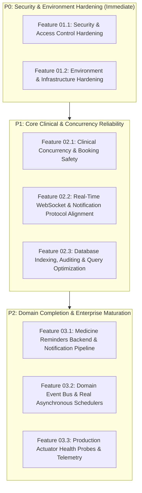

# 📋 PulseCare 2.0 — Prioritized Next Feature Backlog

**Baseline Audit Deliverable:** `NEXT_FEATURE_BACKLOG.md`
**Target Commit:** `be6be662c1b50e58d5fe77439af2ce14e4f4f655`
**Classification:** P0 (Blocker / Critical Security), P1 (High Priority / Architectural Integrity), P2 (Enhancement / Enterprise Readiness)

---

## 1. Executive Roadmapping Strategy

The baseline audit confirms that while PulseCare has an aesthetically pleasing frontend and extensive CRUD domain modules, it currently harbors severe clinical security vulnerabilities (IDOR across appointments/prescriptions, public admin registration, unauthenticated MongoDB exposure) and phantom architectural components (empty schedulers, unused event bus).

Before building new clinical modules (such as mobile apps or lab integrations), the platform must execute a strict **stabilization and hardening phase**.

---

## 2. Prioritized Roadmap & Epics

---

## 3. Detailed Backlog Items

### Priority 0: Immediate Critical Fixes (P0)

#### Feature 01.1: Security, Authorization & Privilege Escalation Hardening
- **Objective:** Eliminate critical OWASP Top 10 API vulnerabilities, IDOR, and privilege escalation vectors.
- **Scope & Key Tasks:**
  1. Remove `role` field from `SignupRequest.dto` and UI; enforce strict `Role.PATIENT` default on public self-registration.
  2. Implement patient record-level authorization checks (`@PreAuthorize` / `SecurityUtils`) in `AppointmentController`, `PrescriptionController`, `InvoiceController`, and `PatientController`.
  3. Fix `SecurityConfig` to grant `ROLE_PATIENT` access to `/api/patients/me`, `/api/patients/{id}/history`, and `/api/patients/{id}/family` with subject matching.
  4. Restrict `CorsConfig` and `WebSocketConfig` allowed origins; eliminate `allowedOriginPatterns("*")` when `allowCredentials(true)` is enabled.
  5. Remove all controller-level `@CrossOrigin(origins = "*")` overrides.
  6. Implement refresh token rotation and token invalidation on logout.
- **Estimated Effort:** 3-4 engineering days.

#### Feature 01.2: Environment Configuration & Infrastructure Hardening
- **Objective:** Ensure zero-config onboarding and production security hygiene.
- **Scope & Key Tasks:**
  1. Mandate strong `JWT_SECRET` generation; remove fallback hardcoded secrets from `docker-compose.yml` and `application.properties`.
  2. Secure MongoDB in Docker Compose with mandatory authentication credentials; avoid exposing port `27017` to the host in production.
  3. Create an automated database seeder (`CommandLineRunner`) to provision documented demo accounts (`admin@pulsecare.com`, `doctor@pulsecare.com`, `patient@pulsecare.com`) with hashed passwords on startup if database is empty.
  4. Provide a configurable dev email bypass mode or mock mail sender so developers and QA can sign up locally without external SMTP credentials.
- **Estimated Effort:** 2 engineering days.

---

### Priority 1: Clinical Integrity & Protocol Alignment (P1)

#### Feature 02.1: Clinical Concurrency & Concurrency Safety
- **Objective:** Prevent double-booking of doctors and hospital beds across horizontal instances.
- **Scope & Key Tasks:**
  1. Add MongoDB compound unique index on appointments: `(doctorId, appointmentDate, appointmentTime)`.
  2. Implement atomic state transition (`findAndModify`) in `BedServiceImpl.bookBed` to guarantee mutually exclusive bed allocations.
  3. Align `AppointmentStatus` enum with actual database values (`PENDING`, `CONFIRMED`, `CANCELLED`, `COMPLETED`).
  4. Introduce `@Version` optimistic locking across `Bed`, `Appointment`, and `DoctorAvailability` document entities.
- **Estimated Effort:** 3 engineering days.

#### Feature 02.2: Real-Time Protocol Normalization & Session Authentication
- **Objective:** Unify WebSocket client and server architectures.
- **Scope & Key Tasks:**
  1. Remove `socket.io-client` dependency and migrate `frontend/hooks/useWebSocket.js` to use `@stomp/stompjs` + `sockjs-client` consistently.
  2. Add STOMP Channel Interceptor in Spring Boot to validate JWT tokens on the `CONNECT` frame and bind the user `Principal`.
  3. Align destination routing: ensure frontend subscribes to `/user/queue/notifications` and backend delivers notifications via `SimpMessagingTemplate.convertAndSendToUser`.
- **Estimated Effort:** 2 engineering days.

#### Feature 02.3: Database Indexing, Auditing & Query Optimization
- **Objective:** Prevent memory exhaustion and enforce proper enterprise audit trails.
- **Scope & Key Tasks:**
  1. Add `@CreatedDate` and `@LastModifiedDate` annotations to entity models to activate Spring Data MongoDB auditing.
  2. Add `@Indexed(unique = true)` on `User.email` and `Bed.bedNumber`.
  3. Refactor `SearchServiceImpl` to replace in-memory streaming of `findAll()` with MongoDB repository criteria and indexed queries.
  4. Implement database-side aggregation pipeline for `ReportsPage` instead of dumping all records to the client browser.
- **Estimated Effort:** 3 engineering days.

---

### Priority 2: Domain Completion & Observability (P2)

#### Feature 03.1: Medicine Reminders Service & Notification Pipeline
- **Objective:** Connect the orphaned frontend `/patient/reminders` UI with a functional backend.
- **Scope & Key Tasks:**
  1. Implement `ReminderController` and `ReminderService` with CRUD operations for `MedicineReminder`.
  2. Implement background execution scheduler to dispatch reminders at configured medication times.
- **Estimated Effort:** 3 engineering days.

#### Feature 03.2: Domain Event Bus & Functional Schedulers
- **Objective:** Implement the event-driven architecture claimed in the documentation.
- **Scope & Key Tasks:**
  1. Wire `AppointmentEventPublisher` into `AppointmentServiceImpl` and implement `@Async` event listeners for notifications and email alerts.
  2. Implement the actual database purge queries in `TokenCleanupScheduler`.
  3. Implement upcoming appointment query and alert dispatch in `AppointmentReminderScheduler`.
- **Estimated Effort:** 2 engineering days.

#### Feature 03.3: Production Actuator Health Probes & Telemetry
- **Objective:** Replace dummy `/api/health` with enterprise monitoring.
- **Scope & Key Tasks:**
  1. Integrate Spring Boot Actuator (`/actuator/health`, `/actuator/metrics`).
  2. Configure Health Indicators for MongoDB ping, disk space, and JVM memory telemetry.
- **Estimated Effort:** 1 engineering day.

---

## 4. Next Recommended Feature

**Recommended Next Feature:**
👉 **`Feature 01.1 – Security & Access Control Hardening`**

**Justification:**
Before any database refactoring or UI enhancements take place, the critical security vulnerabilities—specifically IDOR data leakage of patient appointments and prescriptions, public registration of administrative accounts, and permissive CORS/WebSocket configurations—must be eliminated to make PulseCare safe for clinical use.
