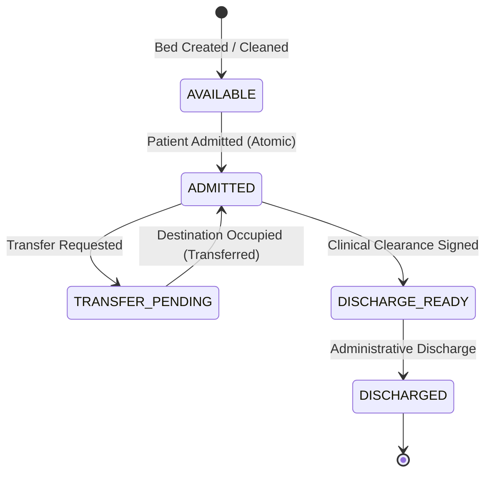

# Patient Inpatient Admission Lifecycle

## 1. State Machine

## 2. Inpatient Transitions
1. **Admission**: Patient must exist and not hold another active admission. Target bed must be `AVAILABLE` and active.
2. **Transfer**: Source bed must match current booking. Destination must be `AVAILABLE`. Source transitions to `CLEANING`.
3. **Discharge Ready**: Attending doctor or admin certifies medical fitness for discharge.
4. **Discharge**: Releases bed to `CLEANING` turnover, closes admission with server Instant, registers billable charge.
