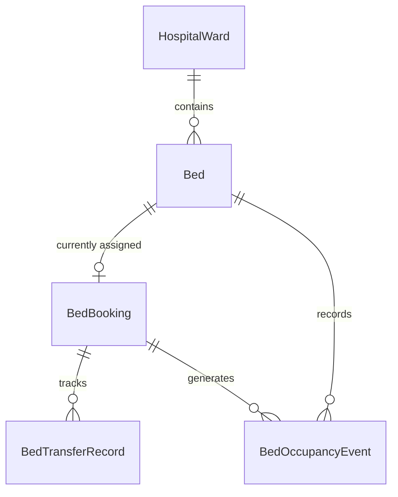

# Inpatient Bed Management Architecture

## 1. Domain Entities & Collections
1. **HospitalWard (`hospital_wards`)**: Physical and administrative hospital divisions (e.g. ICU, General Surgical, Pediatric, Maternity).
2. **Bed (`beds`)**: Individual physical beds linked to wards, with location codes, authoritative Decimal128 daily rates, active status, and turnover states.
3. **BedBooking (`bed_bookings`)**: Enriched inpatient admission entity supporting full lifecycle states (`ADMITTED`, `TRANSFER_PENDING`, `DISCHARGE_READY`, `DISCHARGED`), canonical patient and doctor IDs, and precise Instants.
4. **BedTransferRecord (`bed_transfers`)**: Audit records documenting source and destination beds/wards, actor, and clinical indication.
5. **BedOccupancyEvent (`bed_occupancy_events`)**: Immutable event log enabling chronological audit and retrospective occupancy reconstruction.

