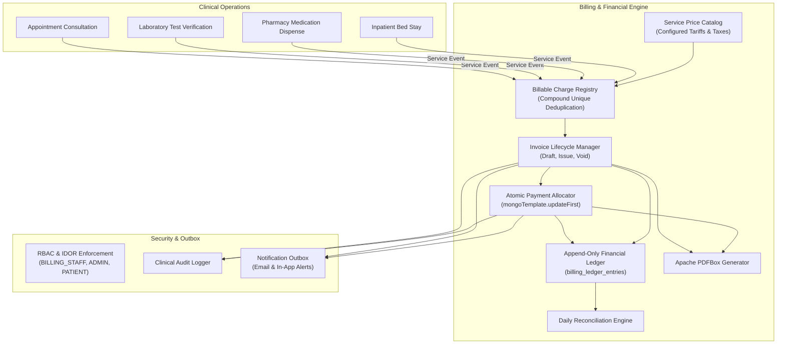

# Hospital Billing & Invoicing Architecture

## 1. High-Level Architecture
PulseCare 2.0 adopts a decoupled, event-driven, double-entry financial architecture integrated into the hospital clinical core.

## 2. Core Architectural Principles
1. **Separation of Clinical and Financial Concerns**: Clinical encounters and pharmacy dispenses create billable charge intents, but never directly manipulate general ledger balances or take money. Reversals of payments never alter clinical medical records.
2. **Deterministic Deduplication**: Every external clinical trigger carries `sourceType`, `sourceId`, and `sourceLineId`. MongoDB enforces compound unique constraints to guarantee zero double billing.
3. **Optimistic Concurrency & Atomic Conditional Writes**: To guarantee zero overpayment in multi-cashier environments, balance deductions use atomic filter criteria in single round-trips.
4. **Append-Only Ledger**: Monetary mutations (charges, cash receipts, card receipts, refunds, credit notes) write immutable ledger entries, enabling exact historical financial audits.
5. **Real MongoDB Multi-Document ACID Transactions & Safe Bounded Retries**: Financial payments and confirmations are executed within real MongoDB replica-set multi-document ACID transactions using `MongoTransactionManager` with bounded exponential backoff retries. Invoice balance mutations, payment documents, and immutable ledger entries commit atomically. In the event of persistence failures, transient write conflicts, or process interruptions prior to commit, the transaction aborts automatically at the MongoDB storage engine level, guaranteeing zero orphan confirmed payments, zero uncommitted ledger entries, and zero balance discrepancies.
6. **External Payment Verification & Staff Settlement**: Non-cash payment methods (`CARD_TERMINAL`, `BANK_TRANSFER`, `INSURANCE_SETTLEMENT`) are recorded in `PENDING` status without balance debiting until staff explicitly verifies and confirms the transaction via `confirmPayment`, guaranteeing that external references alone never trigger false settlement. Unique external references prevent duplicate processing across cashier stations.
