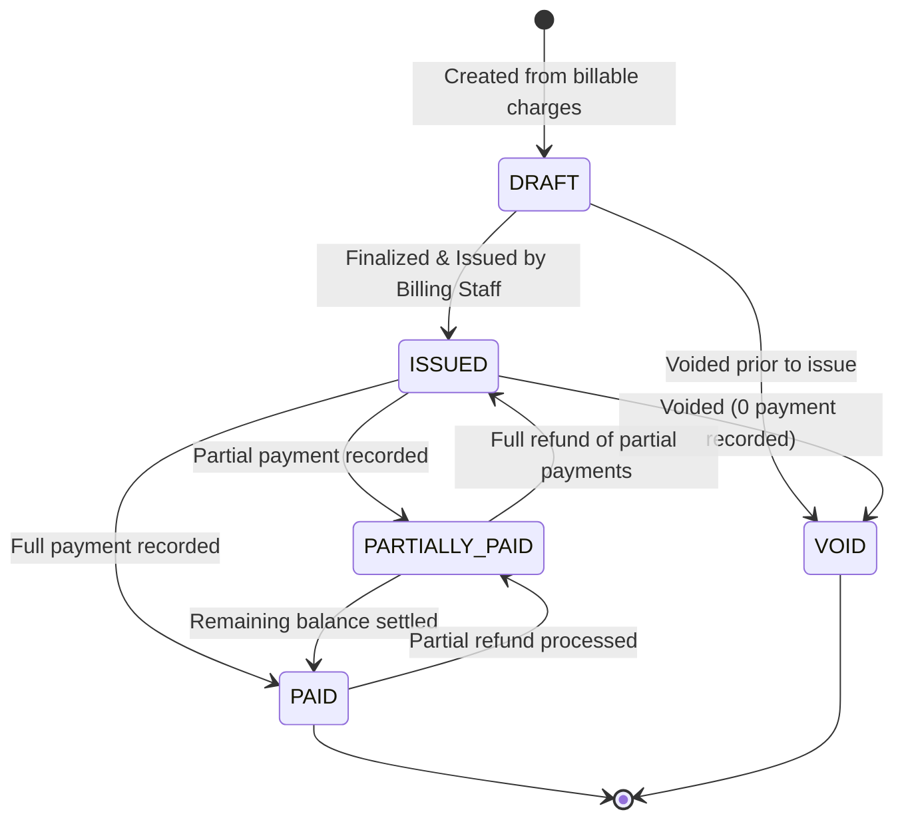

# Invoice Lifecycle Management

## 1. Invoice State Machine

## 2. Invariants & Rules
1. **DRAFT Status**:
   - May be freely modified by billing staff.
   - Associated charges remain referenced.
   - Cannot receive payments until formal issuance.
2. **ISSUED Status**:
   - Amounts, items, and tax snapshots become strictly immutable.
   - Automatically enqueues an `INVOICE_ISSUED` outbox notification to the patient.
   - Generates initial `CHARGE` entry in `billing_ledger_entries`.
   - Outstanding balance equals `totalAmount`.
3. **PARTIALLY_PAID Status**:
   - `0 < paidAmount < totalAmount`.
   - `outstandingAmount = totalAmount - paidAmount`.
   - Cannot be voided; must use Credit Notes or Refunds.
4. **PAID Status**:
   - `paidAmount == totalAmount`.
   - `outstandingAmount == 0.00`.
   - Enqueues `INVOICE_PAID` outbox notification.
5. **VOID Status**:
   - Can only be applied when `paidAmount == 0.00`.
   - Outstanding balance becomes `0.00`.
   - Linked billable charges are released back to `PENDING` status for re-billing or cancellation.
