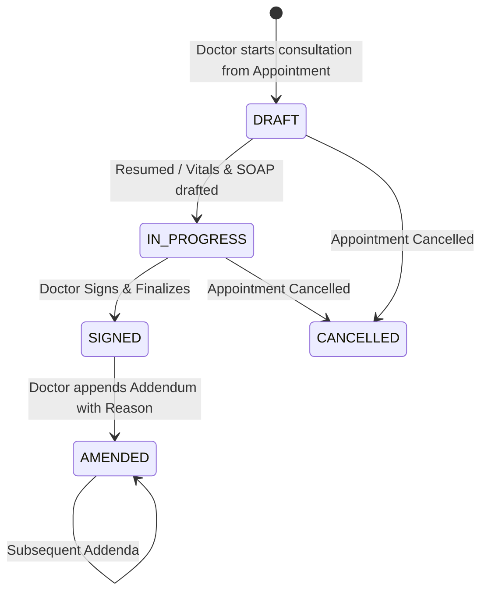

# Clinical Encounter Workflow

### Transition Invariants
1. **Starting Encounter:** Requires non-cancelled appointment. Assigned doctor only. If active encounter exists, resumes existing draft.
2. **Draft Updates:** Only allowed in `DRAFT` or `IN_PROGRESS`. Attempting to update `SIGNED` encounter throws `CLINICAL_005 (SIGNED_NOTE_IMMUTABLE)`.
3. **Signing:** Requires assigned clinician. Freezes note as Revision 1. Generates outbox notification for patient.
4. **Amending:** Requires signed baseline. Incrementing `revisionNumber` to 2+. Mandatory `amendmentReason`. Previous revisions preserved intact.
5. **Patient Visibility:** Patients can only retrieve `SIGNED` and `AMENDED` records. Attempts to read drafts throw `403 Forbidden`.
