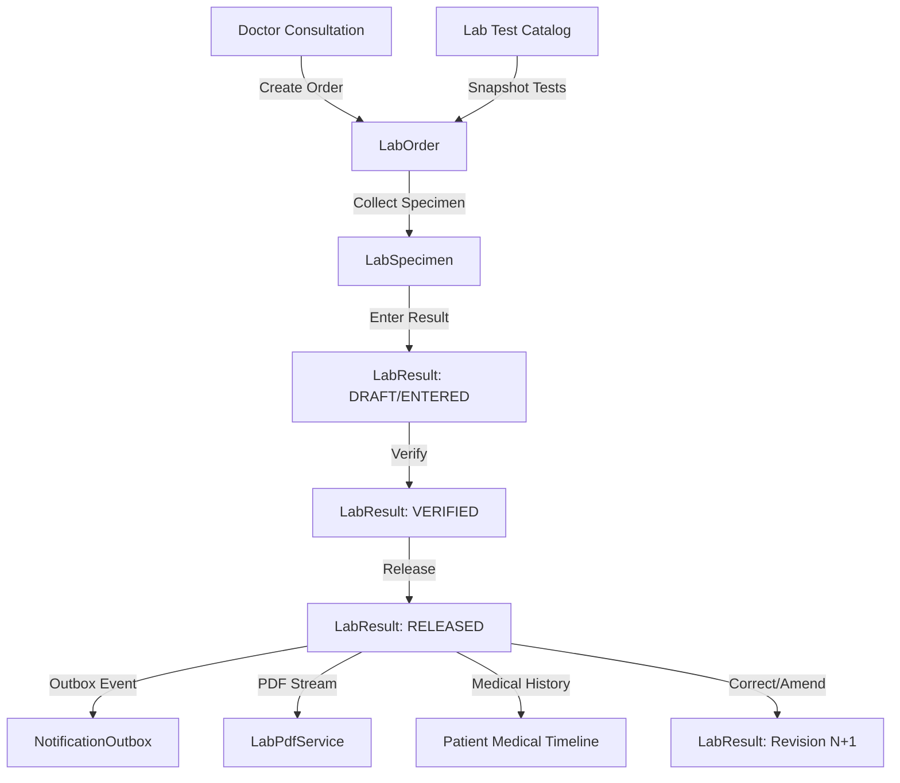

# Laboratory Architecture Specification

## Architecture Overview
The PulseCare 2.0 Laboratory subsystem follows a decoupled, event-aware, domain-driven design within the Spring Boot monolith:

## Core Components
1. **LabTestDefinition & Catalog:** Structured directory of lab tests with specimen requirements and reference ranges.
2. **LabOrder:** Represents physician-requested diagnostic investigations linked to patient, doctor, and optional clinical encounter.
3. **LabSpecimen:** Accessioning and collection tracking from collection to receipt or rejection.
4. **LabResult:** Structured quantitative and qualitative results with optimistic locking and full revision history.
5. **LabPdfService:** Generates downloadable clinical PDF reports.
6. **ClinicalAuditService:** Records auditable events across all laboratory operations.
