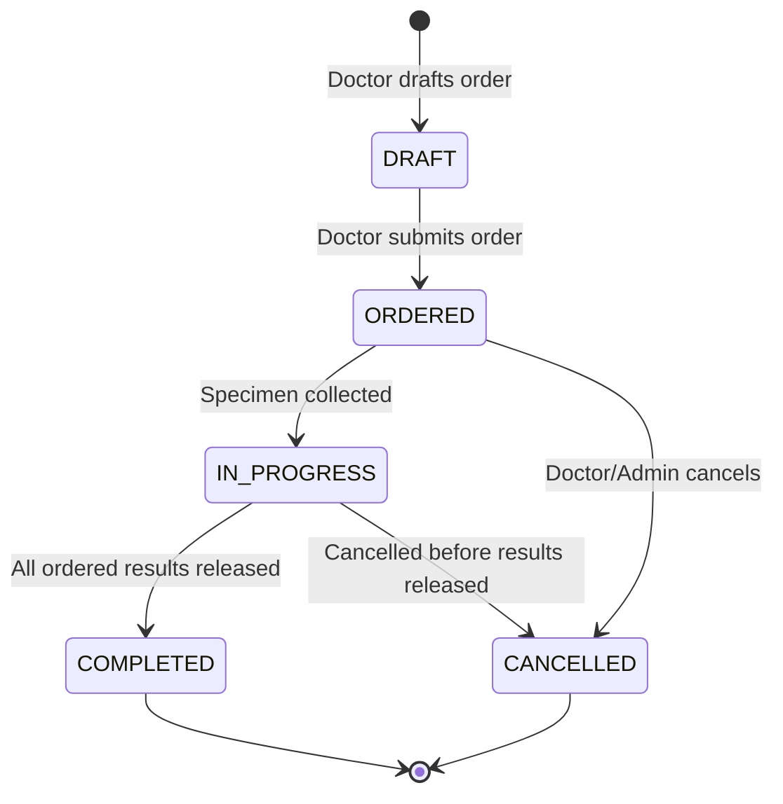

# Laboratory Order Workflow

## Order Lifecycle State Machine

## Clinical Safeguards
- **Doctor Verification:** Only the assigned physician or a doctor with a verified doctor-patient relationship may create lab orders.
- **Active Catalog Enforcement:** Tests can only be ordered from active catalog entries.
- **Encounter Association:** Orders can be tied directly to a `ClinicalEncounter` or `Appointment`.
- **Cancellation Restraints:** Orders cannot be cancelled once results have been released to patient records without initiating the formal clinical correction procedure.
