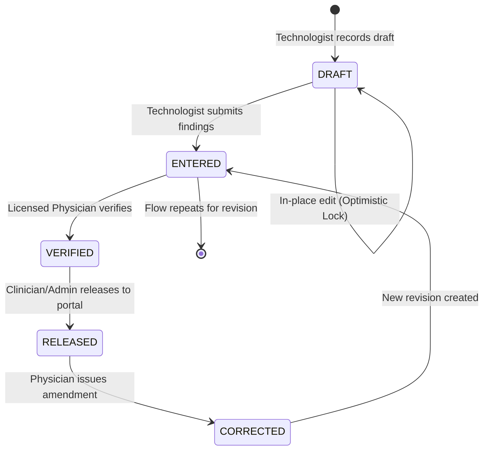

# Result Verification, Release & Correction Lifecycle

## 1. Result State Machine

---

## 2. Gating & Validation Rules
1. **Technician Boundary:** `LAB_TECH` may enter numeric/text findings and update drafts in-place, but cannot verify or release reports.
2. **Draft Immutability for Direct Verification:** `verifyResult()` rejects any result in `DRAFT` status with HTTP 400. Drafts must be submitted as `ENTERED` prior to physician verification.
3. **Clinician Qualification:** Only licensed physicians (`ROLE_DOCTOR`) may verify clinical laboratory results. Administrative staff cannot verify medical findings (`canVerifyLabResult()`).
4. **Release Gate:** Patient portal and medical history access is strictly blocked until status is `RELEASED`. Unreleased findings (`DRAFT`, `ENTERED`, `VERIFIED`, `CORRECTED`) are never exposed to patients.
5. **Amendment Lifecycle:** Released results are immutable. Correcting a result archives the predecessor (`workflowStatus = CORRECTED`) and spawns a new revision (`revision = N + 1`) in `ENTERED` status, requiring complete physician re-verification before release.
