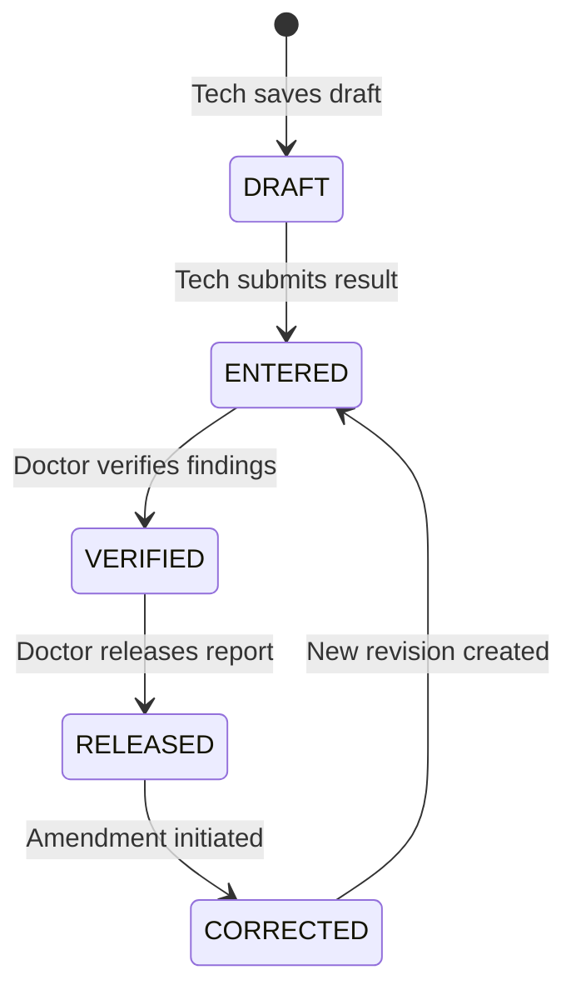

# Result Verification, Release & Correction Lifecycle

## Result State Machine

## Gating Rules
1. **Technician Boundary:** `LAB_TECH` may enter numeric/text findings and save drafts, but cannot verify or release reports.
2. **Clinician Verification:** `DOCTOR` or `ADMIN` must explicitly verify results.
3. **Release Enforcement:** Patient portal access is strictly blocked until status is `RELEASED`. Unverified/draft findings are never returned in patient medical history.
4. **Correction Integrity:** Released results are immutable. Correcting a result archives the previous version and creates a revision document requiring re-verification.
