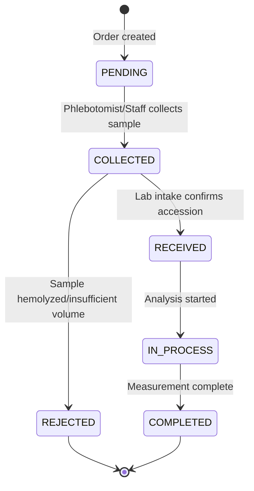

# Specimen Collection & Tracking Lifecycle

## Specimen State Machine

## Security & Identification Controls
- **Accession Identifiers:** Every sample receives a server-generated unique identifier (`SPEC-timestamp-XXXX`).
- **Separation of Collection & Receipt:** Phlebotomy/collection and laboratory intake are tracked independently with user IDs and timestamps.
- **Rejection Tracking:** Rejections require an explicit clinical reason (e.g. hemolyzed, clotted, incorrect container).
- **Patient Safety:** A rejected specimen is never allowed to produce released results.
