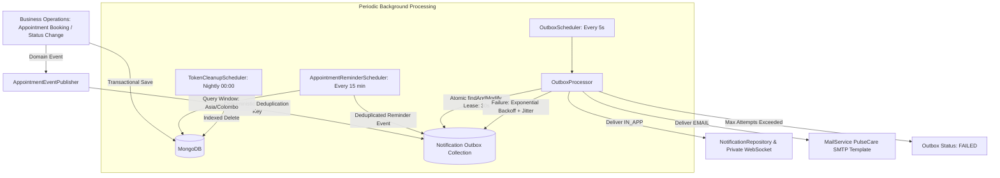

# PulseCare Feature 02.3: Background Jobs, Appointment Reminders and Reliable Notifications Report

## Executive Summary
Feature 02.3 elevates PulseCare's notification and asynchronous task execution architecture from best-effort, in-memory, lossy logging stubs into a durable, transactional MongoDB-backed Outbox pattern with atomic leasing, bounded exponential retries, deterministic deduplication, automated 24-hour appointment reminders in the local business timezone (`Asia/Colombo`), nightly token cleanup, and ownership-enforced WebSocket and REST delivery channels.

This implementation preserves all security, database concurrency, and search performance protections established in Phases 01.1 through 02.2 without introducing third-party message brokers (Kafka/RabbitMQ), cache services (Redis), or external cloud notification providers.

---

## 1. High-Level Architecture Overview

---

## 2. Key Components Delivered

1. **Transactional Outbox Collection (`notification_outbox`)**:
   - Indexed on status, lease times, deduplication keys, aggregate IDs, and recipients.
   - Guarantees at-least-once delivery for in-app and email notifications.
   - Uses atomic `findAndModify` to prevent race conditions across multi-instance hospital deployments.

2. **Automated 24-Hour Appointment Reminders (`AppointmentReminderScheduler`)**:
   - Evaluates upcoming appointments strictly in `Asia/Colombo` timezone.
   - Normalizes and parses human date and time formats into unambiguous UTC `Instant` values.
   - Suppresses past, cancelled, or duplicate reminders.

3. **Nightly Token Purge (`TokenCleanupScheduler`)**:
   - Idempotently removes expired refresh tokens and password reset tokens.
   - Uses indexed `deleteByExpiryDateBefore` to avoid collection scans.

4. **Delivery Security & Access Control**:
   - Enforces record ownership on all notification REST APIs (e.g., `DELETE /api/notifications/{id}`).
   - Secures WebSocket STOMP subscriptions and intercepts/blocks unauthorized `SEND` frames to broadcast queues.

5. **PulseCare Healthcare Email Templates**:
   - Branded transactional email templates with zero external CSS leaks.
   - Configurable frontend base URL for deep linking.
