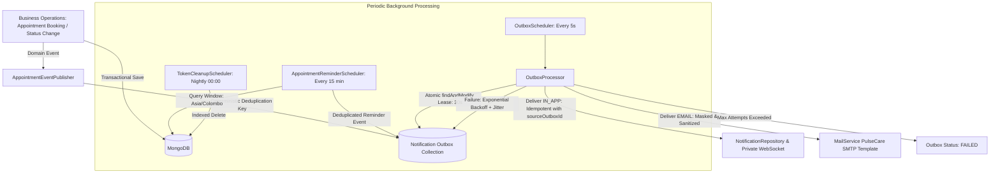

# PulseCare Feature 02.3: Background Jobs, Appointment Reminders and Reliable Notifications Report

## Executive Summary
Feature 02.3 elevates PulseCare's notification and asynchronous task execution architecture into a durable, transactional MongoDB-backed Outbox pattern with atomic leasing, bounded exponential retries, deterministic deduplication, automated 24-hour appointment reminders in the local business timezone (`Asia/Colombo`), nightly token cleanup, and ownership-enforced WebSocket and REST delivery channels.

This correction cycle resolved initial GitHub Actions CI failures, closed WebSocket authorization vulnerabilities, enforced database-level in-app notification idempotency against worker crashes, and ensured schedule-aware appointment reminder generation.

---

## 1. Initial CI Failures & Root Causes

During the initial pull request #14 CI execution, two backend jobs failed:
1. `HMS Enterprise CI Pipeline / Backend Build & Test (Java 17 / Spring Boot)`
2. `Hospital Management System CI/CD / Backend tests`

### Root Cause Analysis:
1. **Dynamic Proxy Bean Type Mismatch (`BeanNotOfRequiredTypeException`)**:
   `OutboxProcessor` injected the concrete implementation `MailServiceImpl` (`private final MailServiceImpl mailService`) instead of the interface `MailService`. Because Spring creates a JDK dynamic proxy (`jdk.proxy2.$Proxy122`) for mail operations, Spring could not cast the proxy to `MailServiceImpl`, causing the Spring `ApplicationContext` initialization to fail closed across all Spring Boot tests.
2. **Ambiguous Service Constructors (`BeanInstantiationException`)**:
   In `AppointmentServiceImpl`, an overloaded 8-argument constructor was introduced alongside the Lombok-generated 9-argument constructor without an explicit `@Autowired` annotation on the primary constructor. Spring's `ConstructorResolver` could not determine the target constructor, failing with `No default constructor found`.

### Resolution:
- Updated `OutboxProcessor` to inject the interface `MailService`.
- Replaced Lombok constructor annotations on `AppointmentServiceImpl` with an explicit `@Autowired` 9-argument constructor and a backwards-compatible 8-argument constructor.
- Re-tested Spring context bootstrap via `BackendApplicationTests`, passing in 16.2 seconds.

---

## 2. High-Level Architecture Overview

---

## 3. Confirmed Security & Reliability Corrections

### A. Strict WebSocket Authorization (Zero Substring Trust)
* **Vulnerability**: Initial validation used `destination.contains(username)`, which allowed substring spoofing (e.g., subscribing to `/user/alice@hospital.com.evil.com/queue/notifications`).
* **Correction**: Enforced strict equality matching against canonical `/user/queue/notifications`. Disallowed any subscription targeting arbitrary user IDs.
* **Broker Protection**: Blocked client `SEND` frames targeting `/topic/**`, `/queue/**`, and `/user/**`.

### B. In-App Outbox Idempotency & Crash Recovery
* **Vulnerability**: If a worker node crashed after inserting a `Notification` but before updating the outbox status to `DELIVERED`, the next worker would insert a duplicate notification on retry.
* **Correction**: Added `sourceOutboxId` with a unique index on the `notifications` collection. On retry, `OutboxProcessor` detects the existing notification, reuses it without duplicating records, and preserves user read state (`isRead`/`readAt`).
* **Stale Worker Guard**: Status updates to `DELIVERED` verify lease ownership (`claimedBy == workerId`), preventing a delayed/stuck worker from overwriting newer database states.

### C. Schedule-Aware Appointment Reminders
* **Issue**: If an appointment was rescheduled after a reminder was queued, either the old reminder would fire or deduplication would block the new reminder.
* **Correction**: Embedded schedule identity (`appointmentDate@appointmentTime`) in the deduplication key. Rescheduled appointments cancel prior pending outbox reminders. When `OutboxProcessor` processes reminders, it verifies that the appointment is still active and that the date/time matches current database records.
* **Strict Time Parsing**: Disallowed silent fallback to 09:00 AM for unparseable times; missing or invalid times return `null` and log a warning.

---

## 4. Delivery Semantics & Non-Claims
* **In-App Notifications**: Database-enforced **idempotent, at-least-once** creation. Live WebSocket delivery is best-effort with private destination routing; stored notifications persist regardless of socket connectivity.
* **Email Notifications**: **At-least-once** delivery via SMTP. Transient network failures trigger exponential backoff. Exactly-once external email delivery is not claimed, as SMTP protocol does not support distributed two-phase commits.
